# JSCP · 外贸与科学计算工具

一款面向外贸业务的 Windows 桌面计算工具。拟物化 2.5D 界面，十进制运算内核，支持亮暗双主题与界面整体缩放。

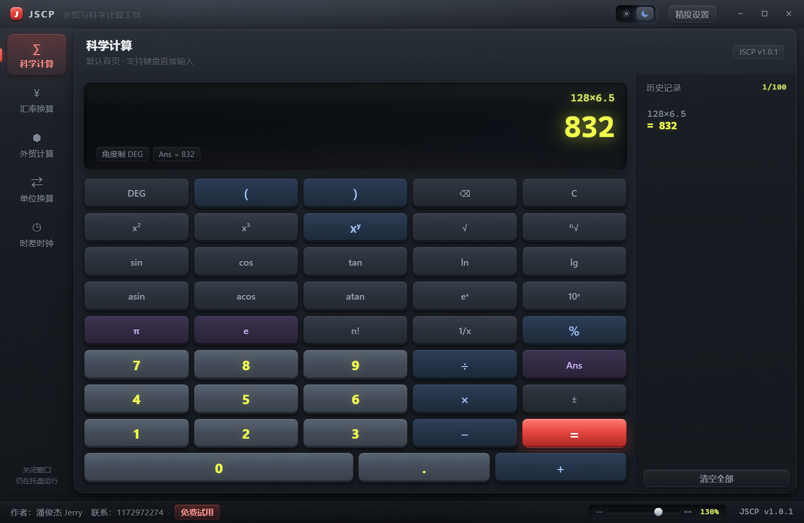

## 功能模块

| 模块 | 说明 |
|---|---|
| **科学计算** | 键盘直接输入，支持隐式乘法、右结合幂、百分号语义。Enter 计算 / Esc 清空，历史记录保留 100 条 |
| **汇率换算** | 一键抓取中国银行外汇牌价（多页逐页抓取 + 去重），统一按「现汇买入价」结算。左侧基准币种，右侧最多 10 个目标币种独立计算 |
| **外贸计算** | CBM 体积、体积重、通用税额、出口退税、进口综合税、货款比例 |
| **单位换算** | 长度、重量、体积、面积、容量、温度、百分比（涨跌幅 / 占比 / 折扣 / 百分比互转） |
| **时差时钟** | 最多 4 地，IANA 时区，自动处理夏令时 |

<details>
<summary><b>展开查看全部界面截图（6 个页面 × 亮暗双主题）</b></summary>

### 汇率换算

一键抓取中行牌价，左侧定基准币种与金额，右侧最多 10 个目标币种各自独立换算。

| 暗色 | 亮色 |
|---|---|
| 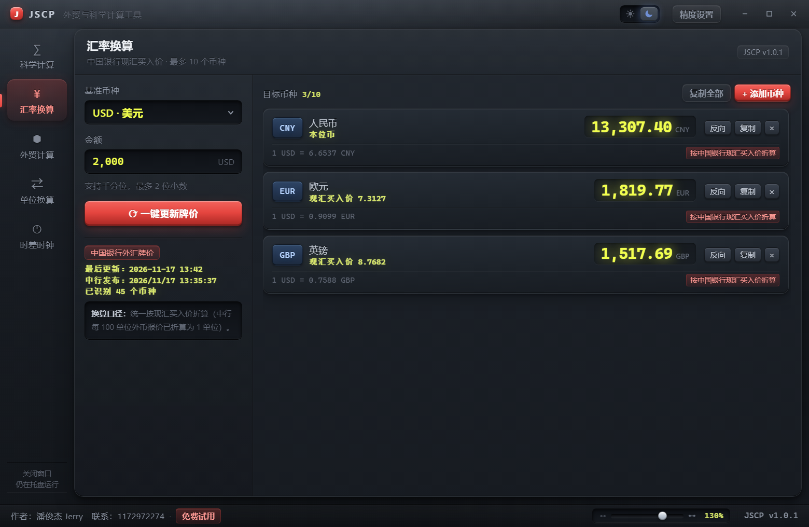 | 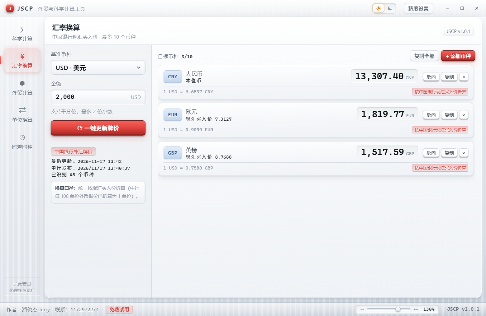 |

### 外贸计算

CBM 体积、体积重、通用税额、出口退税、进口综合税、货款比例，六个常用公式各占一页。

| 暗色 | 亮色 |
|---|---|
| 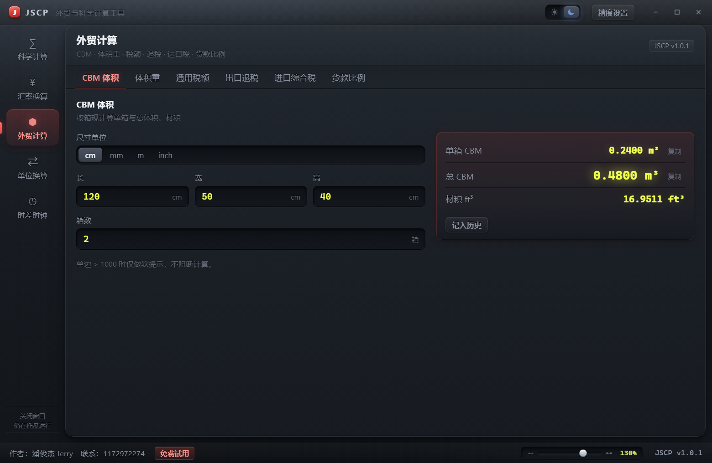 | 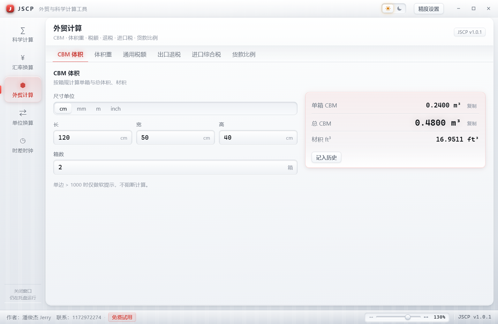 |

### 单位换算

长度、重量、体积、面积、容量、温度六大类，输入任一单位其余自动换算。

| 暗色 | 亮色 |
|---|---|
| 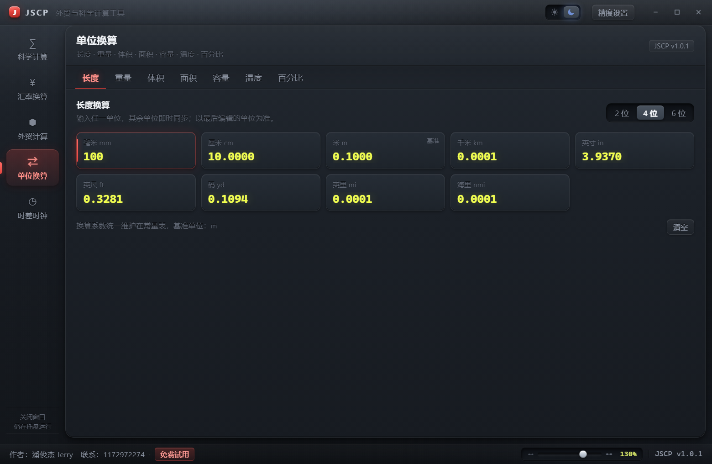 | 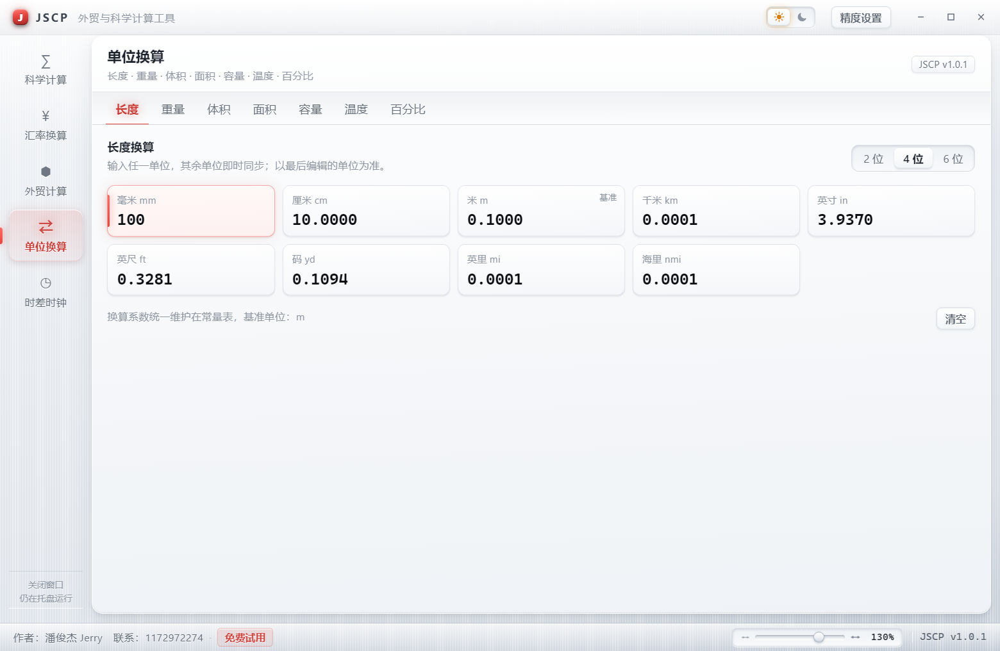 |

### 百分比工具

涨跌幅、占比、折扣、百分比互转四种模式，报价与议价时最常用的一页。

| 暗色 | 亮色 |
|---|---|
| 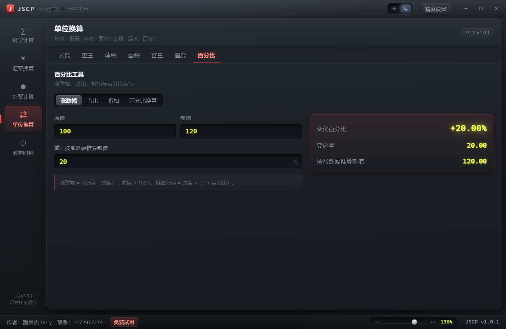 | 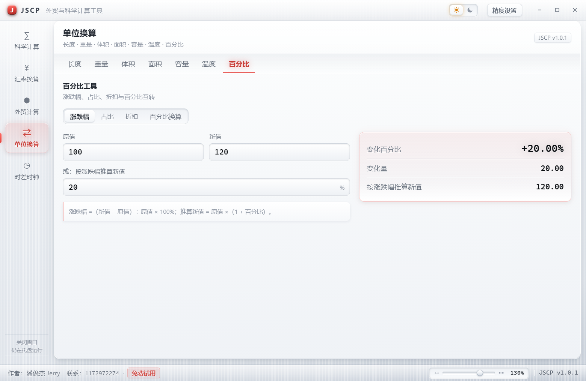 |

### 时差时钟

最多 4 个城市，按 IANA 时区自动处理夏令时，跟客户对时间不用再查表。

| 暗色 | 亮色 |
|---|---|
| 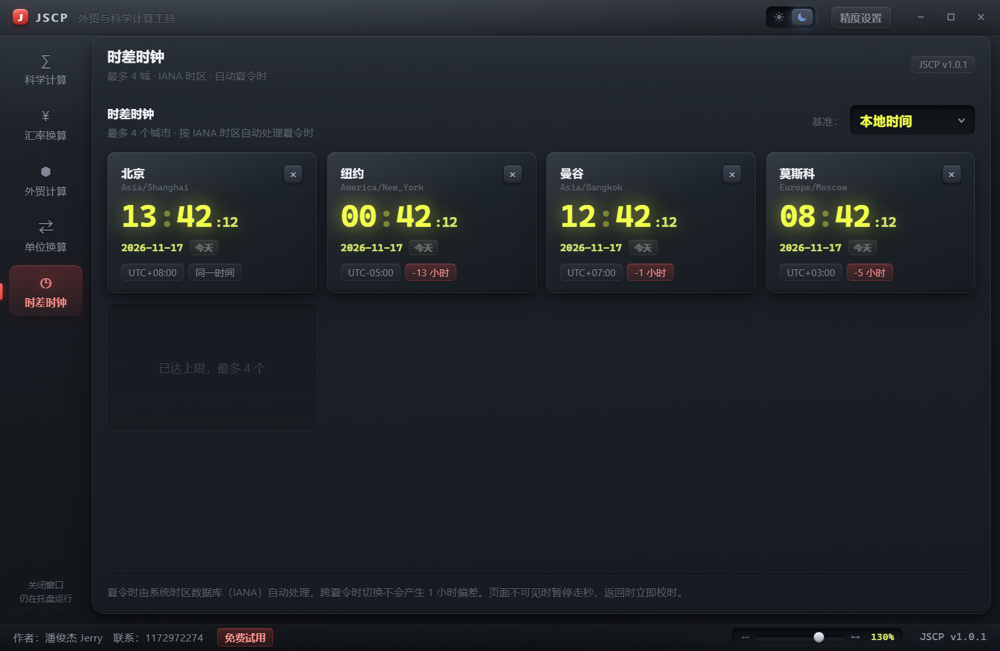 | 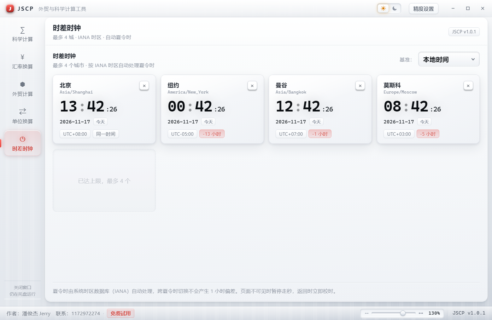 |

### 科学计算（亮色）

| 亮色 |
|---|
| 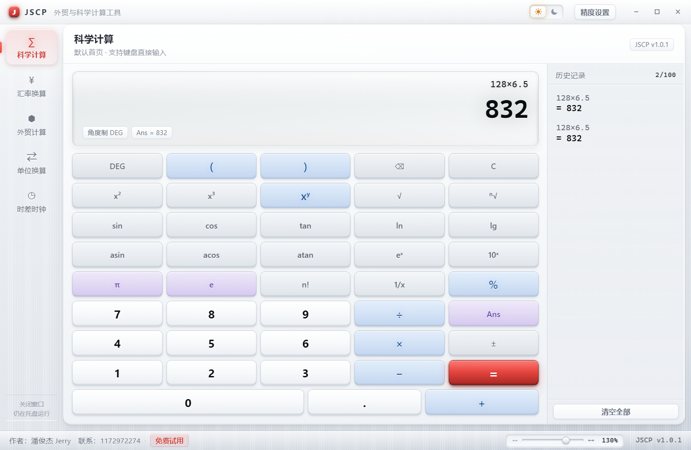 |

</details>

## 核心特性


- **十进制运算内核**：基于 decimal.js（precision 40，ROUND_HALF_UP），`0.1 + 0.2` 精确等于 `0.3`，无浮点误差
- **12 位有效数字**：超过 `1e12` 或小于 `1e-9` 自动转科学计数法；千分位仅作展示层处理
- **自实现三角函数**：sin/cos 泰勒级数 + 参数归约，atan 半角缩减 + 级数展开
- **双主题**：暗色 / 亮色，100+ CSS 变量驱动，太阳 / 月亮按钮切换并自动记忆
- **界面整体缩放**：底栏滑块 75%–150%，基于 Chromium `setZoomFactor`，所有元素等比缩放，窗口尺寸同步调整以保持布局空间
- **数字强调色**：暗色荧光黄 `#f2ff4d`，亮色深黑 `#0a0d11`，统一走 CSS 变量
- **托盘常驻**：关闭窗口收进系统托盘，右键菜单可退出整个进程
- **自定义 8 向窗口缩放**：主进程轮询光标位置 + `setBounds`，任意方向拖拽跟手
- **轻量化**：禁用硬件加速省掉 GPU 进程，裁剪 Chromium 特性，`asar` 打包，安装包约 65 MB

## 技术栈

- **Electron 33** + **React 18** + **TypeScript 5**
- **electron-vite 2** 构建，**electron-builder 25** 打包（NSIS + portable）
- 主进程负责窗口 / 托盘 / 持久化 / 牌价抓取；preload 通过 `contextBridge` 暴露 `window.cluo`
- 渲染层无运行时依赖（decimal.js 已被 vite 内联，`app.asar` 仅约 500 KB）

## 快速开始

```bash
# 安装依赖
npm install

# 开发模式（热更新）
npm run dev

# 类型检查
npm run typecheck

# 构建
npm run build
```

## 打包发布

```bash
# 完整打包：安装版 + 便携版 + 分发包（zip + 使用说明）
npm run pack

# 仅便携版（最快）
npm run pack:portable

# 首次打包若报 winCodeSign 符号链接错误，先修复缓存
npm run fix:cache
```

产物输出到 `build-out/`，其中 `JSCP-v<version>-给同事/` 目录可直接分发。

> **Windows 首次运行提示**
> 程序未购买代码签名证书，Windows SmartScreen 会提示「已保护你的电脑」。点击「更多信息」→「仍要运行」即可。若提示「Windows 已阻止此文件」，右键 exe → 属性 → 勾选「解除锁定」。

## 目录结构

```
src/
├── main/                 # 主进程：窗口、托盘、IPC、牌价抓取
│   ├── index.ts
│   └── rates.ts
├── preload/              # 预加载脚本，contextBridge 暴露 API
├── renderer/             # 渲染层（React）
│   └── src/
│       ├── modules/      # 五个业务模块
│       ├── components/   # 通用组件（数字输入、KV、缩放滑块、缩放热区）
│       ├── state/        # 全局状态与持久化
│       ├── styles.css    # 设计系统与双主题变量
│       └── modules.css   # 模块样式
└── shared/               # 主进程与渲染层共享
    ├── engine.ts         # 表达式解析与求值
    ├── format.ts         # 十进制格式化
    ├── trade.ts          # 外贸业务公式
    ├── types.ts          # 共享类型
    └── version.ts        # 单一版本源
scripts/
├── pack.mjs              # 一键打包
├── fix-cache.mjs         # 修复 electron-builder 缓存
├── make-ico.py           # 纯 Python 生成多尺寸 ICO
└── e2e-script.mjs        # 界面级验收脚本
tests/                    # 计算内核与汇率抓取验收用例
```

## 版本规则

版本号维护在两个位置，**必须保持一致**：`src/shared/version.ts` 的 `APP_VERSION` 与 `package.json` 的 `version`。打包脚本会自动校验，不一致时中止。

- 首版：`v1.0.0`
- 小功能补充 / 修补：第三位 +1 → `v1.0.1`、`v1.0.2` …
- 大板块 / 新模块：第二位 +1 → `v1.1.0`、`v1.2.0` …（第三位归零）

## 测试

```bash
node tests/_bundle.mjs    # 计算内核与业务公式（59 项）
node tests/_rates.mjs     # 汇率抓取与折算口径
```

## 数据来源

汇率数据抓取自 [中国银行外汇牌价](https://www.boc.cn/sourcedb/whpj/)，统一使用「现汇买入价」。抓取失败时保留上次缓存数据，不会清空。

## 作者

潘俊杰 Jerry · 联系：1172972274

## 许可证

暂未选择开源许可证（目前为保留所有权利）。如需对外开源，请先补充 `LICENSE` 文件。
