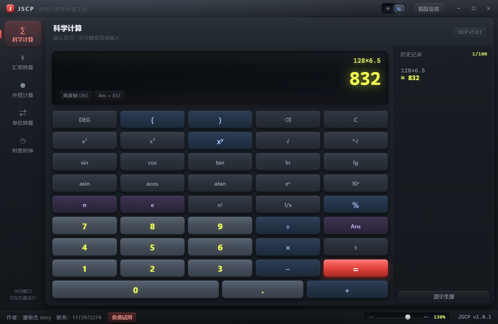
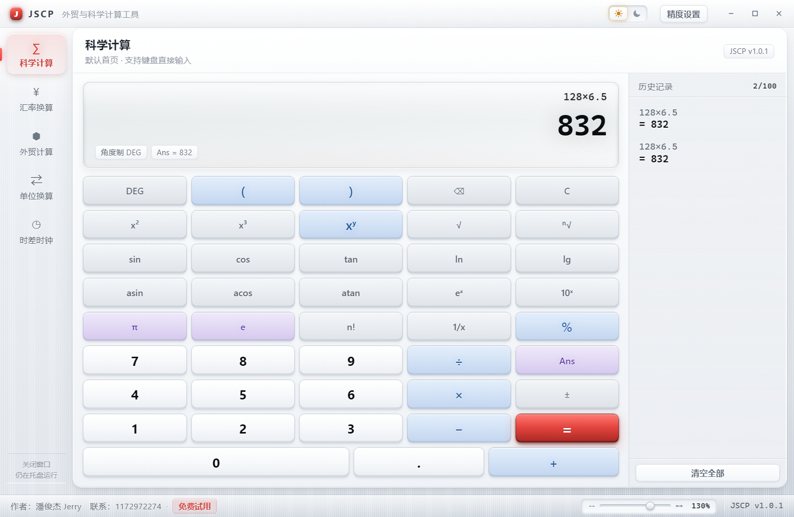
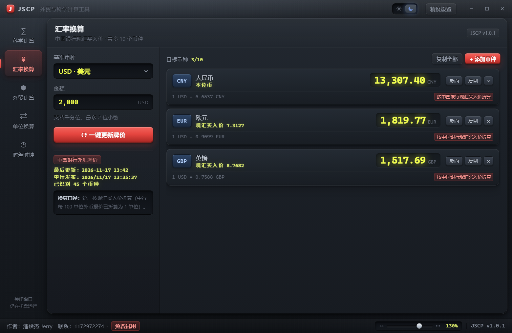
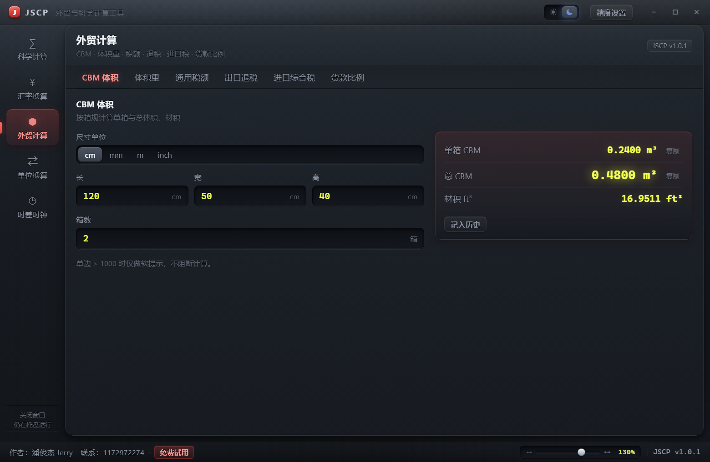
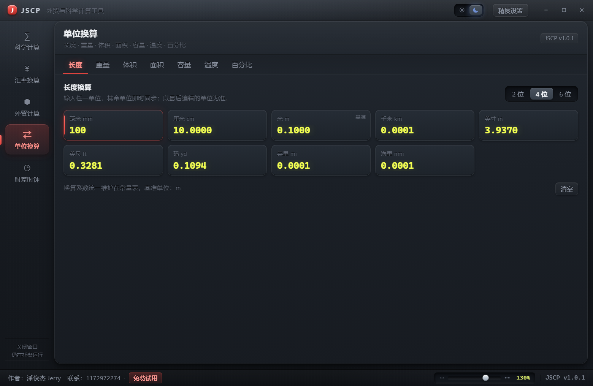
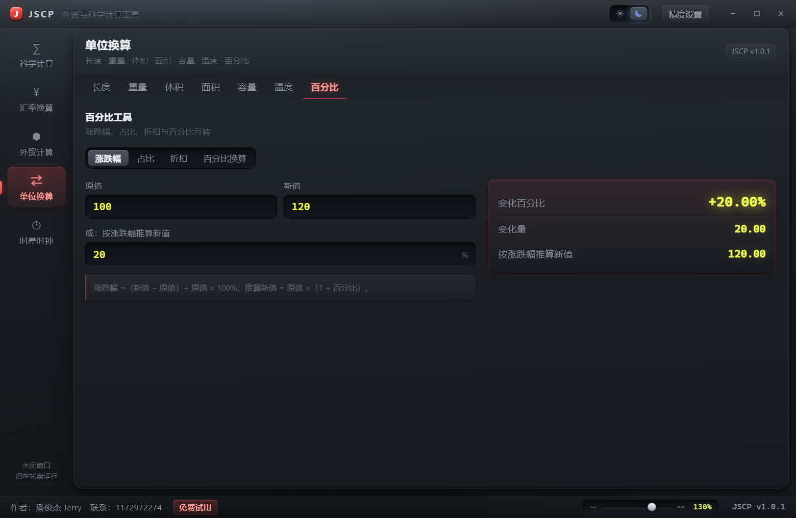
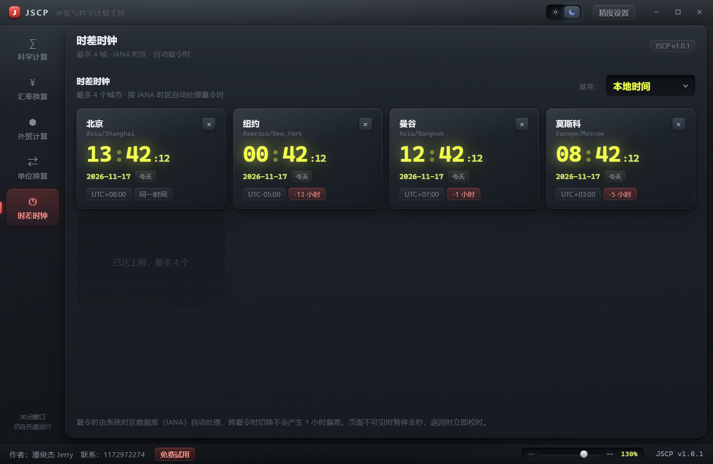

# JSCP 软件介绍

> 外贸与科学计算工具 · Windows 桌面版 · v1.0.1

---

## 一句话说明

**JSCP 是一个把外贸日常要用的六个计算动作装进一个窗口的桌面工具**——报价换算、CBM 体积、出口退税、单位换算、客户时差、科学计算，不用在计算器、网页汇率、Excel 表格之间来回切。



---

## 为什么做这个

做外贸报价的时候，脑子里要在几件事之间反复切换：

- 客户在欧洲，现在是当地几点，他会不会已经下班了
- 这票货 0.36 个方，走空运体积重要除以 6000 还是 5000
- 报价 12.8 美金，退税率 13%，实际能退多少钱
- 今天中行现汇买入价多少，按 7.08 还是 7.12 算

每一件事都有现成的工具，但工具是散的。真正耗时间的是**切换**——打开网页查汇率、再打开 Excel 算退税、再切到手机看时差。一次报价下来，光切窗口就要十几次。

JSCP 的思路很简单：**六个最常用的计算场景，一个窗口，全部到位**。而且因为不联网也能算（除了汇率），出差、见客户、飞机上都能用。

---

## 五个模块，覆盖外贸计算的高频动作

### 一、科学计算 · 键盘直接敲

不是普通计算器的点击式，而是**可以像写算式一样直接打字**。

```
128*6.5-35        →  797
2^10              →  1,024
(85+15)*1.13      →  113
100*15%           →  15
```

支持的写法：

- **隐式乘法**：`2(3+4)` 直接等于 14，不用写 `2*(3+4)`
- **右结合幂**：`2^3^2` 按 `2^(3^2)` 算，得 512，符合数学惯例
- **百分号带入语义**：`200+15%` 理解为「200 加 200 的 15%」得 230，而不是 200.15
- **`Ans` 引用上次结果**，连续计算不用重新输入

<details>
<summary>截图</summary>

| 暗色 | 亮色 |
|---|---|
|  |  |

</details>

**关键点：0.1 + 0.2 精确等于 0.3。** 因为内核用的是 `decimal.js` 十进制运算（精度 40 位），不是 JS 原生浮点数。报价算金额的时候，这个差别是真实的——`0.1+0.2` 在 JS 里是 `0.30000000000000004`，在 JSCP 里就是 `0.3`。

历史记录保留最近 100 条，点一下就能把旧算式重新调回来。

---

### 二、汇率换算 · 一键抓中行牌价

点「一键更新」，程序自动去[中国银行外汇牌价](https://www.boc.cn/sourcedb/whpj/)抓最新数据，**多页逐页抓完再合并去重**，不会只拿到第一页的十几个币种。

统一按 **现汇买入价** 结算——这是外贸结汇最常用的口径。中行页面每 100 外币报一个价，程序内部换算成「1 外币 = ? 人民币」再计算，避免和牌价页面上的数字对不上。



左侧定基准：选币种、填金额。右侧可以**同时挂最多 10 个目标币种，各自独立换算**，互不干扰。

比如基准放「1000 美元」，右侧同时看人民币、欧元、日元、英镑、澳元——五个市场客户各报一种币，一屏看完。

币种可以自由增删。常用的几个固定下来，不常用的删掉，下次打开还是你配置的样子。

抓取失败时会保留上一次的牌价，**不会把你正在看的数字清空**。

---

### 三、外贸计算 · 六个公式各占一页

外贸报价过程中最高频的六个计算：

| 计算项 | 用来干什么 |
|---|---|
| **CBM 体积** | 长×宽×高算立方数，报海运拼箱必用 |
| **体积重** | 按 6000 / 5000 除数算体积重，和实重比大小取大值 |
| **通用税额** | 货值 × 税率，算进口国关税或增值税 |
| **出口退税** | 按退税率反推可退金额，报价时判断利润空间 |
| **进口综合税** | 关税 + 增值税 + 消费税的合并计算 |
| **货款比例** | 定金 / 尾款 / 佣金按比例拆 |



每页都标了公式说明，不用记「体积重到底除 6000 还是 5000」——页面上写着。结果同时给出保留 2 位和 4 位两个版本，报价单要 2 位、内部核算要 4 位，直接取用。

---

### 四、单位换算 · 六类单位 + 百分比工具

长度、重量、体积、面积、容量、温度六大类，**输入任意一个单位，其余单位立刻全部换算出来**——不用选「从什么换到什么」。



温度比较特殊，是仿射换算（华氏、摄氏、开尔文之间有偏移量），单独处理过，不是简单的乘法。

#### 百分比工具（四个模式）

外贸议价几乎天天要用：

| 模式 | 场景 | 例子 |
|---|---|---|
| **涨跌幅** | 客户压价后，算降了几个点 | 原价 100 → 新价 120，涨 `+20.00%` |
| **占比** | 某项费用占总额多少 | 25 / 200 = `12.50%` |
| **折扣** | 打几折之后是多少钱 | 1000 打 8.5 折，减 100 = `750.00` |
| **百分比换算** | % 转小数 / 千分数 / 基点 | 25% = `0.25` = `250‰` = `2500 bp` |



---

### 五、时差时钟 · 最多四地同看

选城市，不用管时区缩写、不用管夏令时——程序按 **IANA 时区**库走，美国夏令时切换、欧洲夏令时切换都自动处理。



最多同时挂 4 个城市。左边是我方时间，右边是客户当地时间，秒针在走。跟客户约会议之前扫一眼就知道「现在发消息他会不会已经下班」。

---

## 界面设计

### 拟物化 2.5D · 偏 macOS 质感

不是扁平化那一套。拉丝金属面板、立体键帽、内凹的 LCD 显示屏、多层内外阴影——按键是有厚度的，屏幕是嵌进去的。

设计上刻意保留了一些「不必要的细节」：键帽边缘的高光、面板的细密纹理、显示屏的微弱内阴影。这些细节对功能没有帮助，但它们让软件看起来像一件东西，而不是一张图。

### 一亮一暗，两个真实可用的主题

顶栏右上角一个太阳、一个月亮，点一下就切。**两套主题都是完整调过的**，不是简单地把背景刷黑——暗色主题下所有面板重新配了阴影层次，亮色主题下的金属质感也是重新做的。

主题选择会记住，下次打开还是你上次用的那个。

### 数字是主角

这是一个计算工具，所以数字必须最显眼：

- **暗色主题下，所有数字用荧光黄 `#f2ff4d`**，带轻微辉光，从深灰背景里直接跳出来
- **亮色主题下，所有数字用深黑 `#0a0d11`**，落在浅灰底上对比度拉满
- 结果区字号 44px，输入框 19px，键帽 20px——都比常规 UI 大一档，扫一眼就能读到

### 界面整体缩放 · 底栏滑块

底栏有个缩放滑块，**75% 到 150% 无级可调**。

关键在于它不是简单地放大字体——它用的是 Chromium 的 `setZoomFactor`，**所有像素、字号、间距、圆角、阴影全部等比缩放**，缩放后布局比例完全不变，只是整体变大变小。同时窗口物理尺寸会同步调整，保证缩放后可用空间不被挤压。

双击滑块回到 100%。设置会记住。

大屏上可以拉到 150% 让字更清楚，小笔记本上缩到 85% 把更多内容塞进一屏。

---

## 一些使用上的细节

**托盘常驻**
点关闭窗口不会退出程序，而是收进系统右下角托盘。右键托盘图标有菜单，可以真正退出整个进程。做报价的时候窗口开开关关很频繁，这样省得每次重新启动。

**窗口随便拉**
八个方向都能拖拽缩放，跟手无延迟。最小 900×600，再小布局会挤。

**免安装**
有安装版和便携版两种。便携版是一个单独的 exe，拷到 U 盘里插到任何一台 Windows 上双击就能用，不写注册表、不留残留。

**能离线用**
除了「一键更新」抓牌价需要联网，其他所有计算全部本地完成。飞机上、客户会议室没网都能用。

---

## 技术信息

| 项 | 说明 |
|---|---|
| 平台 | Windows 10 / 11（64 位） |
| 技术栈 | Electron 33 + React 18 + TypeScript 5 |
| 运算内核 | decimal.js，精度 40 位，ROUND_HALF_UP |
| 有效数字 | 12 位；超过 `1e12` 或小于 `1e-9` 转科学计数法 |
| 安装包体积 | 约 65 MB |
| 内存占用 | 约 170–200 MB |
| 网络依赖 | 仅汇率抓取需要联网 |
| 数据来源 | [中国银行外汇牌价](https://www.boc.cn/sourcedb/whpj/)，现汇买入价 |

**关于 Windows 安全提示**：程序没有购买代码签名证书，首次运行 Windows SmartScreen 会提示「已保护你的电脑」，点「更多信息」→「仍要运行」即可。如果提示「Windows 已阻止此文件」，右键 exe → 属性 → 勾选底部的「解除锁定」→ 确定。

---

## 版本规划

- `v1.0.0` 首个版本，五个模块全部上线
- `v1.0.1` 界面优化：底栏缩放滑块、数字强调色、百分比页补齐
- 后续小功能修补：第三位 +1（`v1.0.2`、`v1.0.3`…）
- 新增模块 / 大板块：第二位 +1，第三位归零（`v1.1.0`）

---

## 反馈

用下来有任何不顺手的、算错的、想要的，都欢迎说。

**作者**：潘俊杰 Jerry
**联系**：1172972274

---

<sub>本文档所有截图均由程序真实运行截取，非设计稿。</sub>
